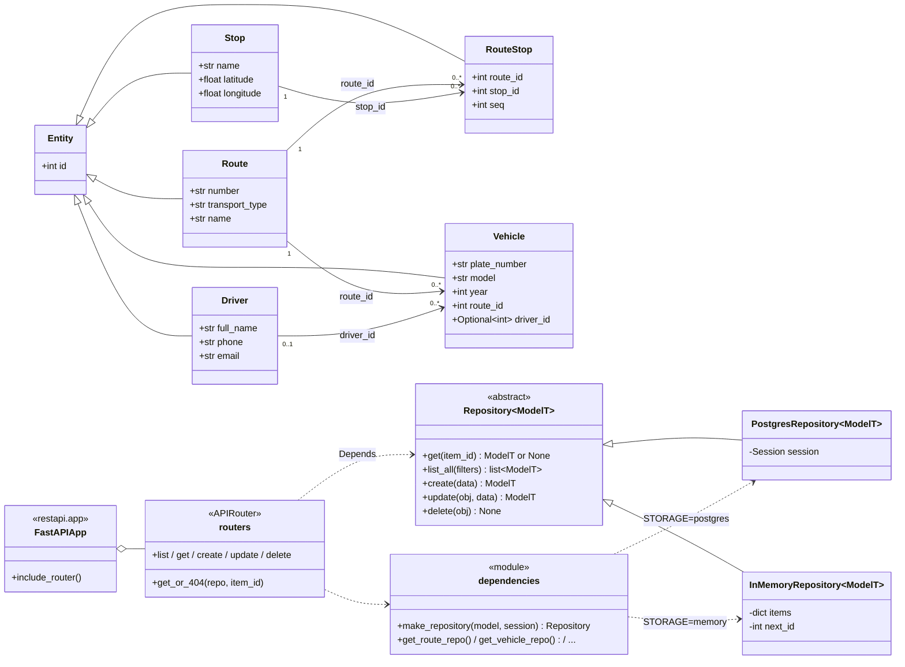

# C4 Code — діаграма класів

Рівень Code моделі C4 показує, з яких класів складається контейнер «REST API»:
доменні класи, абстрактний репозиторій і його реалізації, роутери та функції,
що підставляють репозиторій у роутери.

## Як діаграма показує Open/Closed Principle

- Роутери залежать лише від **абстрактного** `Repository<ModelT>`, а не від `PostgresRepository` чи `InMemoryRepository`.
- Конкретне сховище обирає тільки `dependencies.make_repository()` за змінною `STORAGE`.
- Нове сховище (наприклад, `MongoRepository`) додається як ще один нащадок `Repository` і одна гілка в `make_repository()`. Роутери, моделі та наявні репозиторії не змінюються.
- Новий ресурс — це нова модель, схема, модуль-роутер і один рядок у `restapi.py`.
