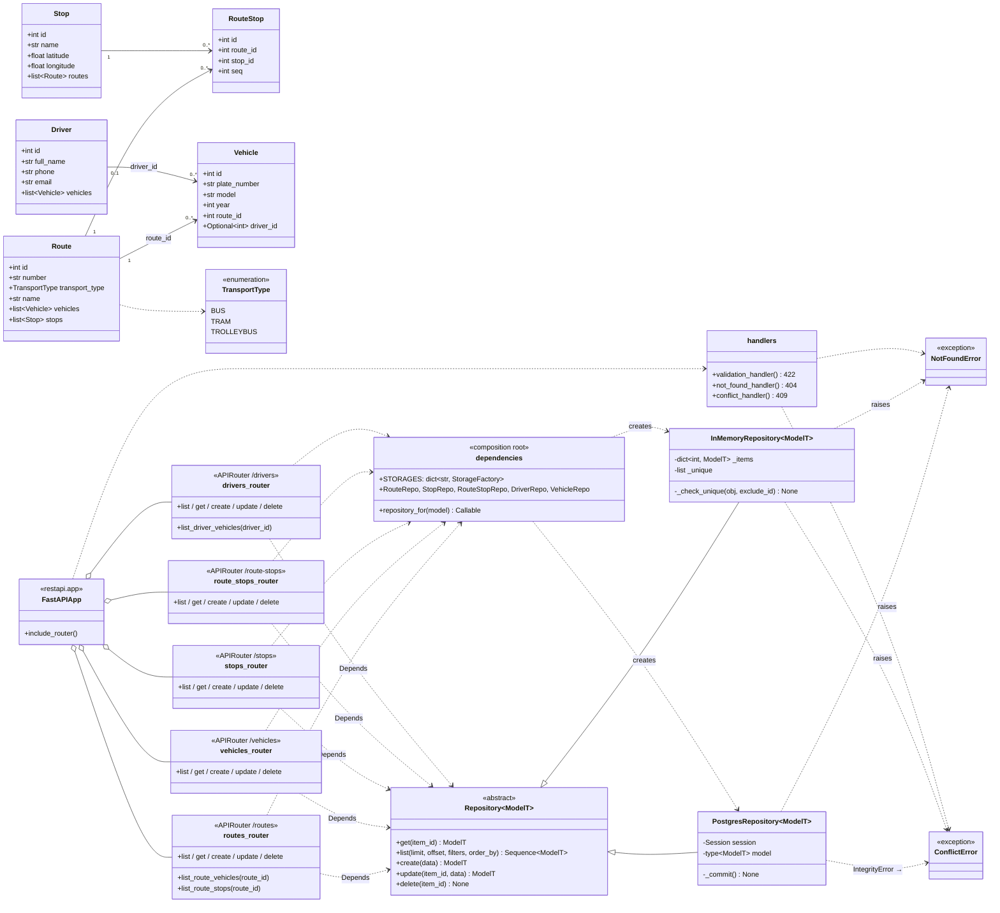

# C4 Code — діаграма класів

Рівень Code моделі C4 показує, з яких класів складається контейнер «REST API»:
доменні класи, абстрактний репозиторій і його реалізації, роутери та корінь композиції.

## Як діаграма показує Open/Closed Principle

- Стрілки від роутерів ведуть лише до **абстрактного** `Repository<ModelT>`, а не до `PostgresRepository` чи `InMemoryRepository`.
- Конкретні класи знає тільки `dependencies` (корінь композиції). Нове сховище, наприклад `MongoRepository`, додається як ще один нащадок `Repository` і один рядок у `STORAGES`. Роутери, моделі та наявні репозиторії не змінюються.
- Новий ресурс додається як нова модель, нові схеми, новий модуль-роутер і один рядок у `ALL_ROUTERS`. Наявні класи також не редагуються.
- Репозиторії кидають доменні `NotFoundError` / `ConflictError`, а не `HTTPException`, тому шар збереження не залежить від FastAPI.
