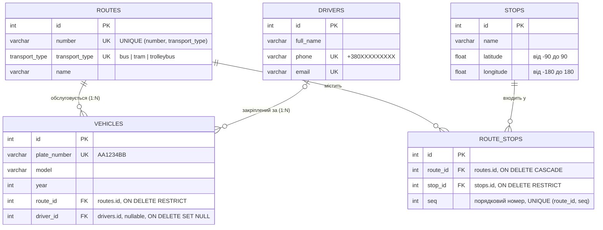

# ERD — модель бази даних «Міський транспорт»

## Зв'язки

| Зв'язок | Тип | Реалізація |
|---|---|---|
| Route → Vehicle | 1:N (з боку Vehicle — N:1) | `vehicles.route_id` → `routes.id` |
| Driver → Vehicle | 1:N, необов'язковий | `vehicles.driver_id` → `drivers.id` (NULL = водія не закріплено) |
| Route ↔ Stop | N:M | асоціативна таблиця `route_stops` з порядковим номером `seq` |

## Правила цілісності

- **UNIQUE**: держномер, телефон і email водія; пара (номер, тип) маршруту, бо номер «1» може мати і трамвай, і автобус; пари (маршрут, зупинка) і (маршрут, seq) у `route_stops`.
- **ON DELETE RESTRICT**: не можна видалити маршрут, за яким закріплено транспорт, і зупинку, що входить у маршрут. API відповідає `409 Conflict`.
- **ON DELETE CASCADE**: разом із маршрутом видаляється його список зупинок.
- **ON DELETE SET NULL**: якщо водія видалили, машина лишається без закріпленого водія.
